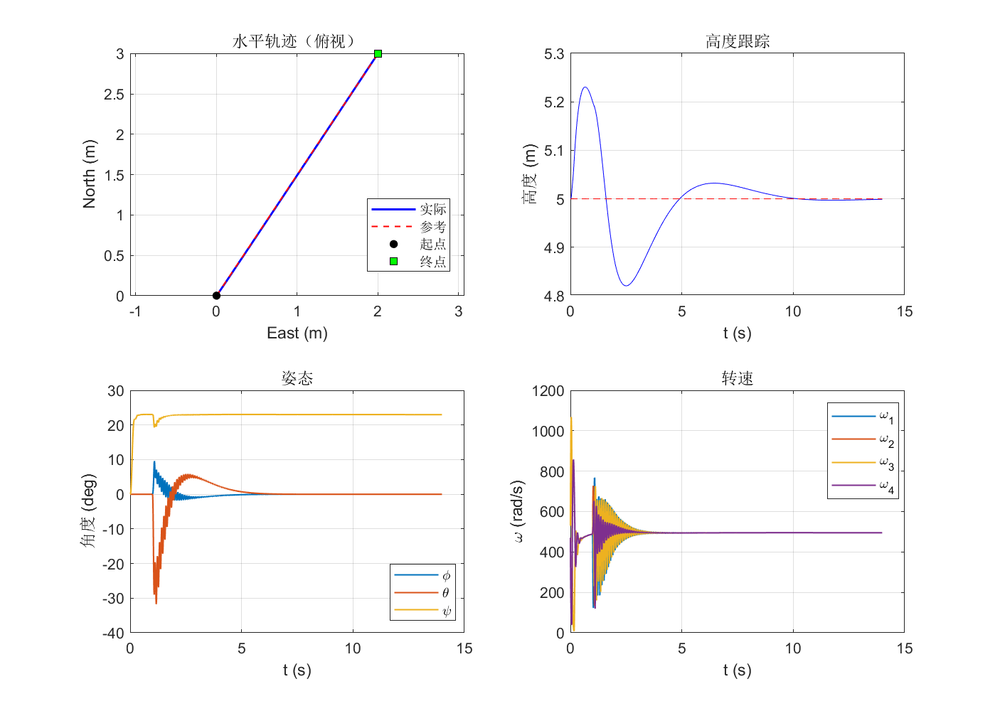
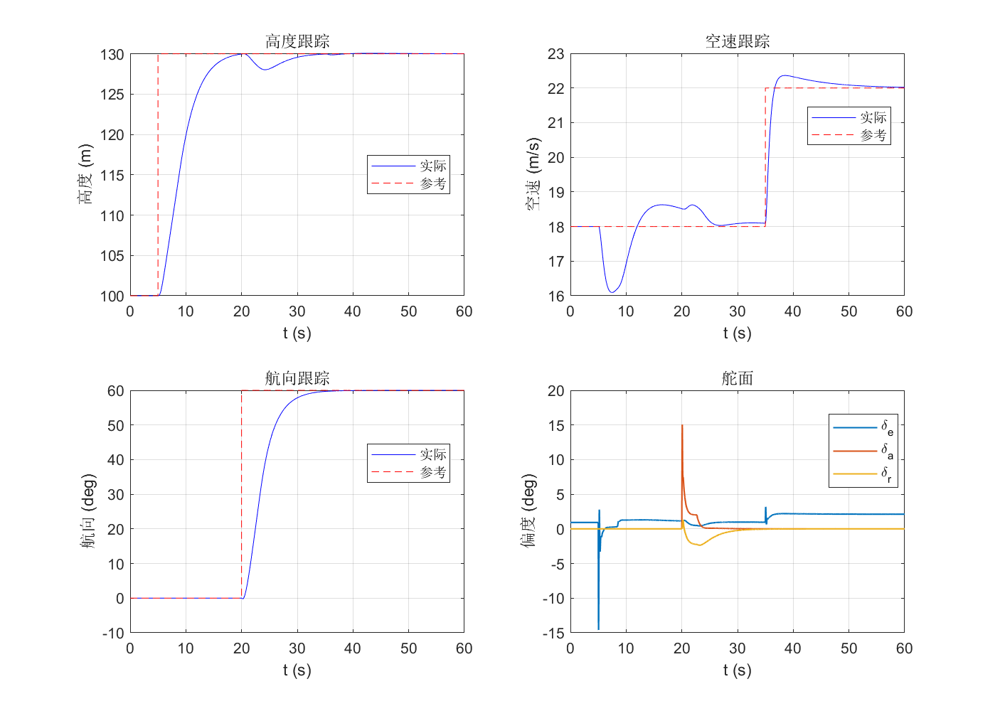
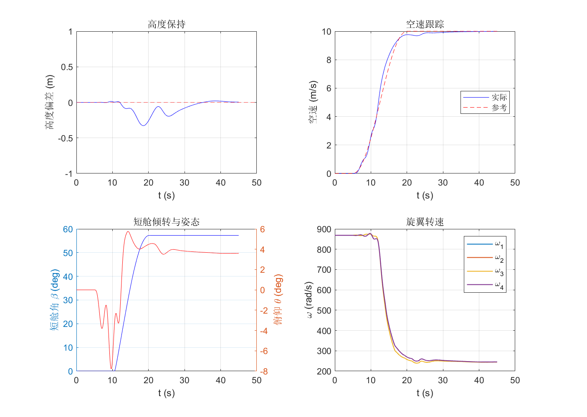
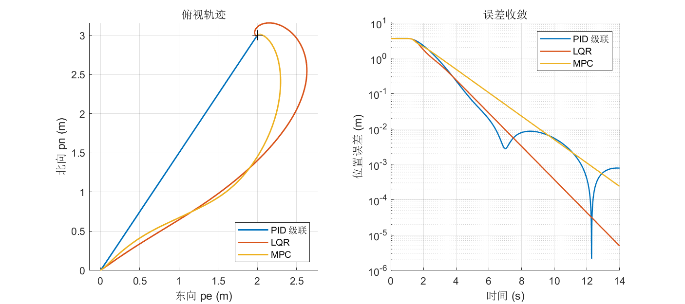
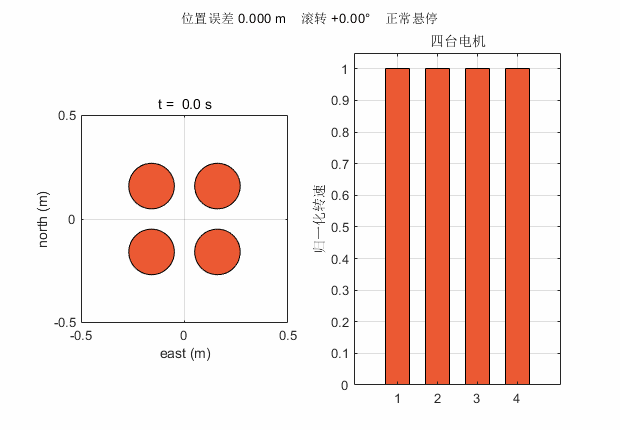

# 无人机 Simulink 仿真框架

[](https://github.com/Qxy661/Simulink-UAV-Dynamics-Sim/actions/workflows/ci.yml)
[](LICENSE)
[](https://www.mathworks.com)
[](https://github.com/Qxy661/Simulink-UAV-Dynamics-Sim/stargazers)

[English](README.en.md) | 中文

四旋翼、固定翼、倾转四旋翼三个构型的闭环仿真，跑在 MATLAB 和 Simulink 两套**分别编写**的实现上，互相对拍；核心循环还能生成 C，装个 gcc 就能跑，不需要 MATLAB。

| 四旋翼位置阶跃 | 固定翼爬升-转弯-加速 | 倾转四旋翼过渡 |
| --- | --- | --- |
|  |  |  |

## 哪三件事值得看

1. **两套实现互相验证，不是一份代码跑两遍。** Simulink 图表里的方程由 `+uav/+model` 生成源码时把参数写成字面量，和 MATLAB 包是两份独立文本，对拍差 1e-15 到 1e-12。差 12 mm 那次是真 bug（积分与执行机构的更新顺序），修完才到这个量级，经过写在 [docs/validation.md](docs/validation.md)。
2. **不装 MATLAB 也能验证。** `codegen/` 里是生成的 C，`c/` 用 Makefile 编出三个运行器，0.2 s 跑完三个构型，CI 拿入库的参考序列逐点比对，超过 1e-9 就红。
3. **倾转四旋翼的包线是查出来的，不是猜的。** v1.0 文档说 12 m/s 起"必然掉高"，逐样本拆竖直力预算后发现是**爬高**，真因是舵面力矩被固定限幅截断（动压一涨，同样的力矩只换来 1/17 的舵偏）。修完 β=90°、空速到 24 m/s 全稳，误判与失败数据都留在 [docs/tiltrotor.md](docs/tiltrotor.md) 和 `research/` 里。

## 当前状态

| 项目 | 结果 |
| --- | --- |
| 单元与闭环测试 | 91 项全部通过 |
| 四旋翼位置阶跃 | 末端误差 0.003 m，最大倾角 30.5° |
| 固定翼任务 | 爬升 30 m、转弯 60°、加速到 22 m/s，终点高度 130.01 m、航向 60.0°、空速 22.02 m/s |
| 倾转四旋翼过渡 | β 0→90°、空速 0→22 m/s，加速段高度峰值 4.0 m、末端 0.01 m，水平误差末段 0.05 m |
| Simulink 对拍 | 四旋翼 14 s 最大偏差 1.1e-15，固定翼 60 s 1.3e-12，倾转四旋翼 45 s 1.3e-11 |
| C 代码生成 | 三个构型生成 C，gcc 编译后同一任务与脚本差 5.9e-14 / 9.1e-13 / 1.4e-12 |
| 控制器基准 | PID 4.19 s / LQR 4.47 s / MPC 5.99 s 调节到 5 cm；35% 降效恢复误差 < 1 cm，见 [docs/benchmark.md](docs/benchmark.md) |
| 状态估计闭环 | IMU/GPS/气压/磁/光流 + 15 维 EKF，60 s 悬停 RMS 7.9 cm；丢星 30 s 漂移 0.09 m，见 [docs/estimation.md](docs/estimation.md) |
| 失效检测与推力裕度 | 断桨检测 4 个控制周期内识别；悬停存活要求单台推力 >= mg/2，本机裕度 1.60（见 [docs/tiltrotor.md](docs/tiltrotor.md)） |
| 阵风抑制 | Dryden 紊流 2 m/s + 平均风 [3;2;0] m/s：PID 0.145 m → ESO 0.006 m（24 倍），见 [docs/disturbance.md](docs/disturbance.md) |
| 理论教程 | 11 个部分、61 篇，见 [tutorials/](tutorials/README.md) |
| Simulink 版本 | R2024a，只用基础模块与 MATLAB Function |

## 快速开始

```
git clone https://github.com/Qxy661/Simulink-UAV-Dynamics-Sim.git
cd Simulink-UAV-Dynamics-Sim
```

```matlab
addpath(pwd);
uav.demo('step');          % 四旋翼位置阶跃，出图到 figures/
uav.demo('hover');         % 定点悬停
uav.demo('yaw');           % 航向阶跃
uav.demo('fw');            % 固定翼：爬升 30 m、转弯 60°、加速到 22 m/s
uav.demo('tilt');          % 倾转四旋翼：悬停、短舱前倾、巡航
uav.demo('wind');          % 阵风下 PID 与 ESO 对比
runtests('tests')          % 91 项，约 68 s
```

一条命令跑完全部检查（测试、三个模型对拍、C 运行器对拍）：

```matlab
cd scripts
verify_all
```

生成并校验 Simulink 模型：

```matlab
cd scripts
build_quad_model           % models/quad_closed_loop.slx
validate_model             % 与脚本实现对拍
build_fw_model             % models/fw_closed_loop.slx
validate_fw_model
build_tilt_model           % models/tilt_closed_loop.slx
validate_tilt_model
```

不用 MATLAB 跑三个构型（需要 gcc）：

```
cd c
mingw32-make               % Linux/macOS 用 make
mingw32-make run           % 写 out/quad.csv、out/fw.csv、out/tilt.csv
build\uav_quad_runner      % 单独跑四旋翼
```

## 目录

```
+uav/
  +cfg/        参数：四旋翼机体、四旋翼控制器、固定翼机体、固定翼控制器、倾转四旋翼机体/控制器、仿真设置
  +plant/      刚体六自由度、四旋翼混控与电机、固定翼气动与配平、倾转四旋翼力与力矩、四元数工具
  +ctrl/       四旋翼级联控制器、固定翼级联控制器、倾转调度与分配、LQR、MPC、角度归一化
  +env/        四旋翼悬停与阶跃参考、固定翼任务参考、倾转任务参考
  +sens/       IMU、GPS、气压计、磁力计、光流采样
  +est/        15 维误差状态 EKF 与各类量测更新
  +sim/        三个构型的积分器、带传感器的闭环、指标统计、故障注入
  +model/      Simulink 图表源码生成器
  +codegen/    C 代码生成入口
  demo.m       演示入口
tests/         matlab.unittest 测试（57 项）
scripts/       模型生成、对拍、代码生成、基准、一键验证
codegen/       生成的 C 源码（入库，可脱离 MATLAB 编译）
c/             独立运行器、Makefile、参考序列
docs/          架构、验证、基准、估计、三个构型推导、C 代码生成
models/        生成的 .slx
tutorials/     11 个部分的理论教程（约 1 MB）
figures/       演示图与动图
```

## 控制器对比基准

同一条 3.6 m 阶跃、同一架四旋翼，换三种控制器各跑 14 s。

| 控制器 | 调节时间 s | 末段 RMS m | 最大倾角 ° | 饱和占比 % | 单次耗时 s |
| --- | --- | --- | --- | --- | --- |
| PID 级联 | 4.19 | 2.16e-3 | 30.45 | 1.64 | 1.60 |
| LQR | 4.47 | 1.25e-4 | 54.58 | 1.29 | 2.10 |
| MPC | 5.99 | 2.02e-3 | 75.03 | 1.07 | 7.48 |



LQR 与 MPC 都会先偏出去再收回，轨迹不是直线；误差曲线的末值排序与表里 RMS 一致。MPC 是自己拼的 condensed QP，没用 MPC 工具箱——工具箱默认给 12 个输出加积分扰动，参考阶跃时估出巨大扰动，0.3 s 就把推力压到底。这段弯路写在 [docs/benchmark.md](docs/benchmark.md)。

单电机 35% 降效的恢复过程：故障电机转速被伪逆分配器抬高，位置误差回到毫米级，代价是偏航不可控。



完全停转（`eta = 0`）会因反扭矩缺口自旋，20 s 飞出去 2.3 km，所以只演示降效。原因见 [docs/benchmark.md](docs/benchmark.md)。

## 状态估计闭环

前面所有控制器都吃仿真真值。`uav.sim.run_est` 换成传感器量测：IMU 200 Hz（陀螺零偏 0.02 rad/s）、GPS 5 Hz（水平 1 m）、气压计 20 Hz、磁力计 50 Hz、下视光流 50 Hz，15 维误差状态 EKF 估计姿态、位置、速度与两类零偏。

60 s 悬停，控制器只用估计值：

| 项目 | 数值 |
| --- | --- |
| 位置 RMS（30 s 后） | 0.079 m |
| 最大偏差 | 0.130 m |
| 陀螺零偏估计 | [0.0199, −0.0149, 0.0099] rad/s（真值 [0.020, −0.015, 0.010]） |
| GPS 丢星 30 s | 末端漂移 0.09 m（靠光流维持） |
| 理想传感器闭环 | 末端 5.2 cm |

三条硬约束写在 [docs/estimation.md](docs/estimation.md)：控制周期必须 ≥500 Hz，加速度计姿态更新必须门控，GPS 地速比位置差分可靠。原本想做到 5 cm，实测压到 7.9 cm 后继续降增益只让倾角变小、误差不降，判断是传感器噪声的下限。

## 约定

状态 13 维，顺序固定，四旋翼与固定翼共用：

```
x = [pn; pe; pd; u; v; w; qw; qx; qy; qz; p; q; r]
```

- 世界系 NED，机体系 FRD，四元数为 body 到 NED。
- 欧拉角按 ZYX 顺序解算，`quat2euler` 返回 `[phi; theta; psi]`；抬头为正。
- 四旋翼电机编号：1 右前、2 右后、3 左后、4 左前。1/3 逆时针，2/4 顺时针，`a = arm/sqrt(2)`。
- 四旋翼混控矩阵 `B` 把转速平方映射到 `[T; Mx; My; Mz]`，控制器用 `inv(B)`。
- 固定翼配平变量为迎角 `alpha`、升降舵 `de`、油门 `thr`，平飞时俯仰角等于迎角。
- 倾转四旋翼状态 21 维：13 维刚体 + 短舱角 + 4 转速 + 3 舵面，β=0 推力朝上、β=90° 朝前。

完整推导与符号见 [docs/architecture.md](docs/architecture.md)，固定翼见 [docs/fixedwing.md](docs/fixedwing.md)，倾转四旋翼见 [docs/tiltrotor.md](docs/tiltrotor.md)，C 代码生成见 [docs/codegen.md](docs/codegen.md)，测试数值见 [docs/validation.md](docs/validation.md)。文档索引在 [docs/README.md](docs/README.md)。

## 教程

`tutorials/` 是 11 个部分的理论教程：坐标系与动力学推导、Simulink 建模、PID/LQR/MPC、状态估计、VTOL 与风扰、SIL/HIL、PX4 对接、论文导读。

和代码对应的读法：02 解释 `+uav/+plant/rigid_body.m`，04 解释 `+uav/+ctrl/cascade.m` 的姿态反解，06 解释固定翼与倾转构型。章节索引见 [tutorials/README.md](tutorials/README.md)。

## 设计取舍

**参数用函数返回 struct，不用脚本。** 旧版把 `quad_params.m` 当脚本执行，函数里静态解析看不到 `quad` 变量，会落到内置 `quad.m` 上，报"输入参数的数目不足"。现在 `uav.cfg.quad()` 返回结构体，调用处类型明确。

**控制器带状态 struct。** 积分项存在 `st.ip`、`st.ia`、`st.iV` 里，不用全局变量，函数保持 codegen 友好、可重复调用。

**两套实现互相对拍。** Simulink 图表代码由 `+uav/+model` 生成，参数写成字面量，模型自包含，不依赖 MATLAB 路径。方程改动后重跑生成器即可，避免两份代码手工同步。

**同一套积分顺序。** 脚本与模型都先更新执行机构、再在整步内视为常值做 RK4，记录也都在积分之前。四旋翼早期版本在积分后更新电机，与模型差 12 mm；统一顺序后降到 1e-15 量级。

**测试断言物理量。** 比如"向北有误差时应低头""等转速不产生力矩""电机一步后到 63.2%""升降舵正偏产生低头力矩"，不是只检查函数能不能返回。

**生成的 C 入库。** `codegen/` 里是 `uav.codegen.*_sim` 生成的 C 源码（三个构型各一目录），`c/` 用 gcc 编译成独立运行器。目的不是"能生成"，是让别人 clone 下来不装 MATLAB 也能跑出同一条轨迹：CI 按构型矩阵用入库的参考序列比对，误差超过 1e-9 就红。代价是每次改方程要重跑 `scripts/codegen_c.m`，这一点由 `scripts/validate_c_runner.m` 保证。

## 已知限制

- 气动只有线性系数：四旋翼是机体轴阻力，固定翼是线性升阻与三轴力矩导数，没有失速、非定常、桨叶挥舞、地面效应、风场。
- 电机与舵机都是一阶惯性加限幅，没有电流环、没有间隙与死区。
- 固定翼控制器在 18 m/s 平飞点整定，大迎角或低速段未做增益调度。
- 倾转四旋翼打通了加速段：β 0→90°、空速到 24 m/s；**减速回悬停仍未收敛**（70 s 末端高度 26 m、空速 4.2 m/s），见 docs/tiltrotor.md 的未解决项。
- 单电机完全停转时反扭矩缺口让机体自旋，位置环收敛不了，只演示 35% 降效。
- 未做完整 SO(3) 大角度机动，姿态误差仍按欧拉角计算。

## 版本

v1.0.0。变更记录见 [CHANGELOG.md](CHANGELOG.md)。

## 贡献

见 [CONTRIBUTING.md](CONTRIBUTING.md)。提 issue 请附 MATLAB 版本、构型和复现命令。

## License

MIT，见 [LICENSE](LICENSE)。

## 研究记录

`research/` 下 18 份记录：包线、减速能量账、失效包线、悬停鲁棒性、估计与抗扰。每份都写清楚问题、数据、结论和边界，负结果也留着。入口 [research/INDEX.md](research/INDEX.md)。
